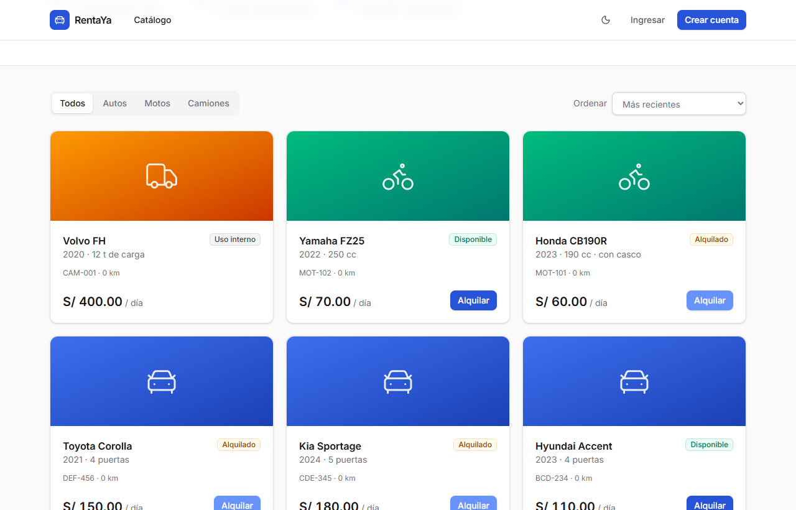
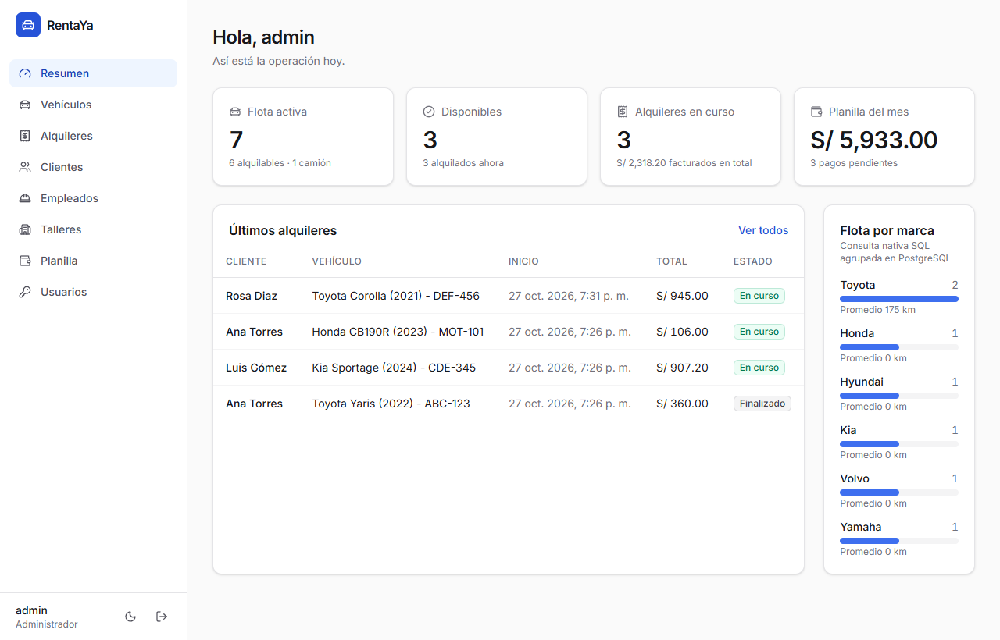
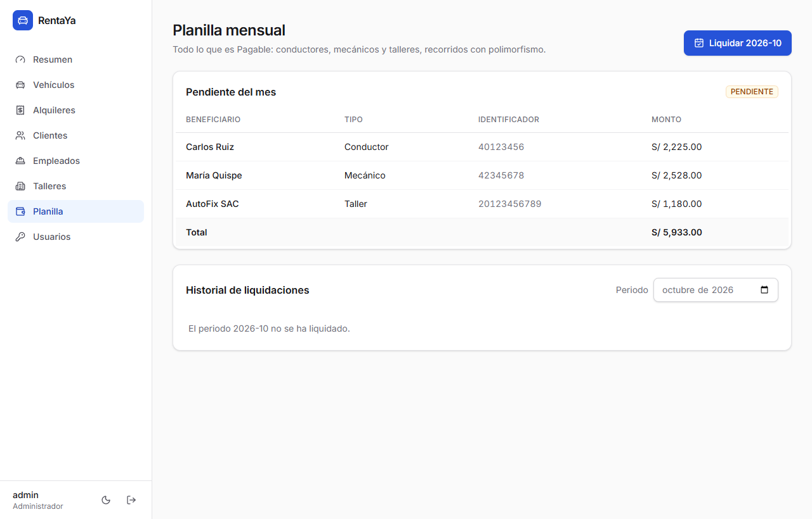
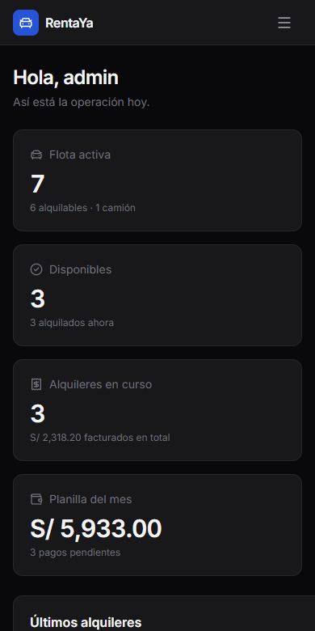

# RentaYa Web

[](https://github.com/hard747/rentaya-web/actions/workflows/ci.yml)


Frontend da **RentaYa**, uma concessionária de veículos. Consome a API REST
[**rentaya-api**](https://github.com/hard747/rentaya-api) (Java 21 + Spring Boot) e
oferece um catálogo público, a área do cliente e um painel de gestão para a empresa.

**Demo:** <https://rentaya-web-1fgw.onrender.com> · API: <https://rentaya-api-b2q2.onrender.com/swagger-ui.html>
(plano gratuito do Render: o primeiro acesso após um período sem uso pode levar cerca de 1 minuto,
e a interface avisa enquanto o servidor acorda).



| Painel da empresa | Folha de pagamento | Celular, tema escuro |
|---|---|---|
|  |  |  |

## Funcionalidades

| Perfil | O que pode fazer |
|---|---|
| Visitante | Ver o catálogo com filtros, ordenação e paginação; criar conta |
| **Cliente** | Ver o preço final antes de confirmar, alugar e acompanhar os próprios aluguéis |
| **Funcionário** | Registrar aluguéis para clientes, devoluções, quilometragem e custo de manutenção; cadastrar clientes |
| **Administrador** | Tudo o que o funcionário faz, mais frota, funcionários, oficinas, folha mensal e usuários |

## Stack

| Camada | Tecnologias |
|---|---|
| Interface | React 19, TypeScript, Tailwind CSS 4, ícones Lucide |
| Rotas | React Router (rotas protegidas por papel, carregamento sob demanda) |
| Dados | TanStack Query (cache, paginação, invalidação após cada operação) |
| Formulários | React Hook Form + Zod no cadastro e login; validação nativa no painel |
| Testes | Vitest, Testing Library, jsdom |
| Entrega | GitHub Actions (lint, testes, build), site estático no Render |

## Arquitetura

```
src/
├── lib/            api.ts (HTTP + token + erros), auth.tsx (sessão), sesion.ts (JWT), types.ts (DTOs da API)
├── components/     ui.tsx (botões, campos, tabela, modal), layouts, rota protegida, modal de aluguel
└── pages/          Catálogo, Login/Cadastro, Meus aluguéis e panel/ (uma página por recurso)
```

## Decisões de projeto

**O backend é a fonte da verdade.** O preço que o cliente vê antes de confirmar vem de
`GET /alquileres/cotizacion`: os descontos (7 dias, moto, cliente premium) existem uma única
vez, no modelo de domínio em Java, e o frontend não os duplica.

**Papéis no frontend são só experiência de uso.** O menu e as rotas mudam conforme o papel
lido do JWT, mas a segurança real está na API: sem o papel certo ela responde 403, mesmo que
alguém altere o JavaScript no navegador.

**Token JWT em `localStorage`.** É simples e funciona entre domínios diferentes (frontend e API
ficam em serviços separados). A contrapartida é a exposição a XSS; a alternativa seria um
cookie `HttpOnly` com `SameSite`, que exigiria proteção CSRF no backend. A sessão expira
sozinha no vencimento do token, e qualquer 401 da API encerra a sessão.

**CORS.** Como o frontend roda em outro domínio, o navegador só permite as chamadas porque a
API responde com `Access-Control-Allow-Origin` para as origens configuradas em `CORS_ORIGENES`.

**Carregamento sob demanda.** O catálogo público chega primeiro; o painel e os formulários são
baixados só quando o usuário entra neles (`React.lazy`).

**Servidor dormindo.** Se uma requisição demora mais de 4 segundos, a interface explica que o
servidor gratuito está acordando, em vez de parecer travada.

## Como executar

Com a [API](https://github.com/hard747/rentaya-api) rodando em `http://localhost:8080`:

```bash
npm install
npm run dev        # http://localhost:5173
```

Para apontar para outra API, crie um `.env` a partir do `.env.example`:

```
VITE_API_URL=https://rentaya-api-b2q2.onrender.com
```

## Testes

```bash
npm test           # Vitest
npm run lint       # oxlint
npm run build      # verificação de tipos + build de produção
```

| Arquivo | O que verifica |
|---|---|
| `lib/sesion.test.ts` | leitura do JWT: papel, cliente, expiração e tokens inválidos |
| `lib/api.test.ts` | header `Authorization`, erros da API por campo, 401 encerra a sessão, 204, falha de rede |
| `App.test.tsx` | fluxos completos com a API simulada: catálogo, aluguel com preço do backend, login, validação do cadastro e permissões por papel |

## Deploy

O `render.yaml` descreve um **site estático** no Render: `npm ci && npm run build`, publica a
pasta `dist`, reescreve todas as rotas para `index.html` (SPA) e define `VITE_API_URL`.
No backend, a origem do site precisa estar em `CORS_ORIGENES`.
